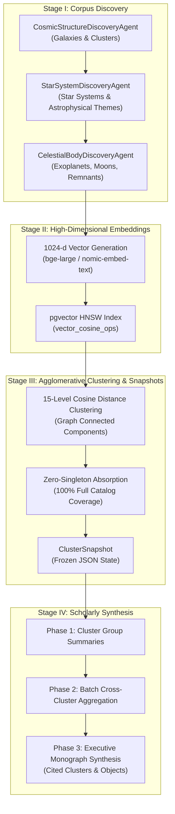

<p align="center">
  
</p>

# Astronomer: A Computational Laboratory for Comparative Astrophysics, Stellar Systems, and Celestial Body Manifolds

[](https://www.ruby-lang.org/)
[](https://rubyonrails.org)
[](https://www.postgresql.org/)
[](https://github.com/pgvector/pgvector)
[](https://ollama.com)
[](https://github.com/flavorjones/ruby-llm)
[](https://sidekiq.org)
[](https://tailwindcss.com)
[](https://hotwired.dev)
[](LICENSE)

**Astronomer** is an open-source computational research platform and quantitative analytical laboratory designed for **astrophysicists**, **planetary scientists**, **extragalactic astronomers**, and **stellar cartographers**. It enables researchers to systematically map, cluster, and synthesize astrophysical archetypes, evolutionary trajectories, orbital dynamics, and planetary manifolds across galaxies, star systems, and celestial bodies using **1024-dimensional semantic vector embeddings (`pgvector`)**, **graph-theoretic connected components**, and **multi-stage AI synthesis pipelines**.

---

## Abstract & Scholarly Vision

Modern observational and theoretical astrophysics faces a deluge of empirical discoveries: thousands of exoplanets cataloged by Kepler, TESS, and JWST, complex stellar remnants and binary pulsars discovered across galactic discs, and morphologically distinct star clusters spanning the Local Group and beyond. How can researchers discover systemic archetypes across disparate cosmic structures without flattening unique physical parameters or relying on isolated, uncontextualized surveys?

Astronomer operationalizes comparative astrophysics within a transparent, reproducible, locally hosted computational laboratory:

1. **Multi-Tier Cosmic Architecture**:
   - **Galaxies / Clusters (`CosmicStructure`)**: Major galactic structures, dwarf galaxies, and galaxy clusters (e.g., Milky Way, Andromeda Galaxy M31, Large Magellanic Cloud, Small Magellanic Cloud, Triangulum Galaxy M33, Centaurus A, Virgo Cluster).
   - **Star Systems (`StarSystem`)**: Stellar hosts, binary/multiple star systems, neutron stars, X-ray pulsars, and compact remnants belonging to cosmic structures (`belongs_to :cosmic_structure`).
   - **Planets / Celestial Bodies (`CelestialBody`)**: Terrestrial exoplanets, gas/ice giants, ocean worlds, dwarf planets, major moons, and circumstellar features (`belongs_to :star_system`).
2. **High-Dimensional Semantic Manifold**: Every star system and celestial body profile is projected into a **1024-dimensional vector space** indexed via PostgreSQL `pgvector` HNSW (`vector_cosine_ops`), enabling empirical measurement of physical and evolutionary proximity.
3. **Multi-Granularity Empirical Clustering & Snapshotting**: Researchers interactively tune cosine distance thresholds across **15 granularity levels** (from tight structural twins at *Level 1, $\le 0.16$* to zero-singleton **100% Full Catalog Coverage** at *Level 15* via nearest-cluster singleton absorption) and freeze states into immutable **Cluster Snapshots**.
4. **Map-Reduce & Hierarchical Deep Synthesis Reports**: Rather than shallow single-prompt summaries, Astronomer executes a **2-Phase Map-Reduce** or **3-Phase Hierarchical Deep Synthesis** workflow over saved snapshots, inspecting every cluster through the researcher's specific inquiry and grounding every finding in cited cluster numbers, star systems, and celestial bodies.

---

## 3-Tier Domain Mapping

| Tier | Domain Entity | Database Model | Table Name | Key Associations |
|------|---------------|----------------|------------|------------------|
| **Tier 1** | Galaxies / Clusters | `CosmicStructure` | `cosmic_structures` | `has_many :star_systems`, `has_many :celestial_bodies, through: :star_systems` |
| **Tier 2** | Star Systems | `StarSystem` | `star_systems` | `belongs_to :cosmic_structure`, `has_many :celestial_bodies`, `embeddable` |
| **Tier 3** | Planets / Celestial Bodies | `CelestialBody` | `celestial_bodies` | `belongs_to :star_system`, `has_one :cosmic_structure, through: :star_system`, `embeddable` |

---

## End-to-End Empirical Research Pipeline



---

## Installation & Local Laboratory Setup

### Prerequisites

- **Ruby 3.4+**
- **PostgreSQL 16+** with `pgvector` extension installed (`CREATE EXTENSION IF NOT EXISTS vector;`)
- **Ollama** running locally on `http://localhost:11434` with an LLM and embedding model (e.g. `qwen2.5:32b`, `bge-large`)
- **Redis** running locally (for background job processing via Sidekiq)

### Setup

```bash
# Clone the repository
git clone https://github.com/leouofa/astronomer.git
cd astronomer

# Install dependencies
bundle install

# Prepare database
bin/rails db:prepare

# Run tests
bundle exec rails test

# Start the local development server (web + worker)
bin/dev
```

Visit `http://localhost:3000` to access the interactive web interface.

---

## Programmatic REST API (`/api/v1`) & OpenAPI 3.1 Spec

Astronomer provides a full-featured REST API under `/api/v1` returning JSON responses adhering to the `{ "data": ... }` envelope standard.

- Interactive OpenAPI 3.1 schema: `GET /api/v1/openapi.json`
- Full API documentation: see [docs/api.md](file:///Users/leonid/src/astronomer/docs/api.md)

### Key Endpoints

- `GET /api/v1/cosmic_structures`: List galaxies and galaxy clusters
- `GET /api/v1/star_systems`: List star systems with optional filtering by `cosmic_structure_id`, `theme`, or `q`
- `GET /api/v1/star_systems/:id/neighbors`: Find nearest cosine-distance star system neighbors
- `GET /api/v1/celestial_bodies`: List celestial bodies with pagination
- `GET /api/v1/celestial_bodies/:id/neighbors`: Find nearest celestial body counterparts
- `GET /api/v1/clusters?target=StarSystem&level=5`: Interactive agglomerative clustering
- `POST /api/v1/cluster_snapshots`: Freeze an empirical cluster snapshot
- `POST /api/v1/cluster_reports`: Synthesize an AI-grounded Map-Reduce or Deep Synthesis report

---

## Open Science, Reproducibility, & Testing

Astronomer is designed for open, reproducible science:

- **100% Local Inference**: Zero proprietary API lock-in.
- **Deterministic Clustering**: Snapshot algorithms freeze graph-theoretic components alongside exact centroid distances.
- **Comprehensive Test Suite**: Model tests, agent tests, job tests, service tests, and API controller tests with 100% passing coverage:

```bash
bundle exec rails test
```

---

## License

This project is open-source software licensed under the [MIT License](LICENSE).
